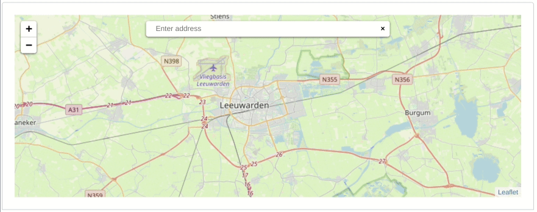
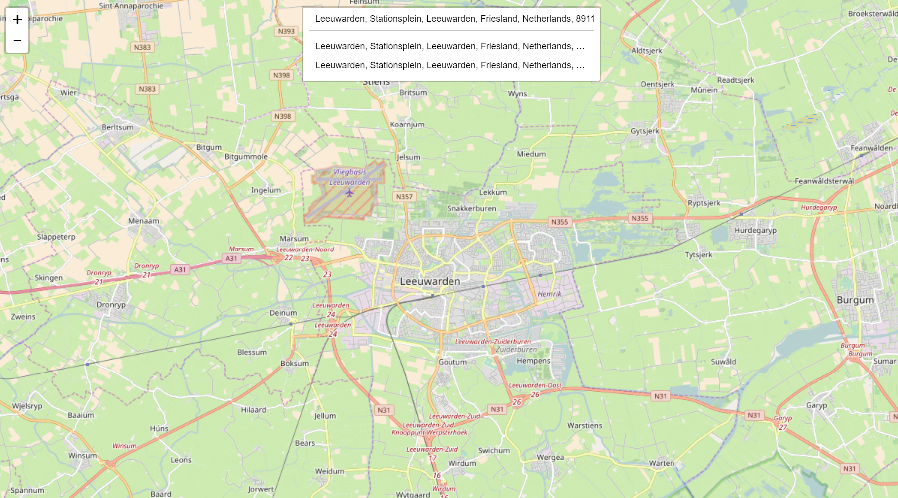
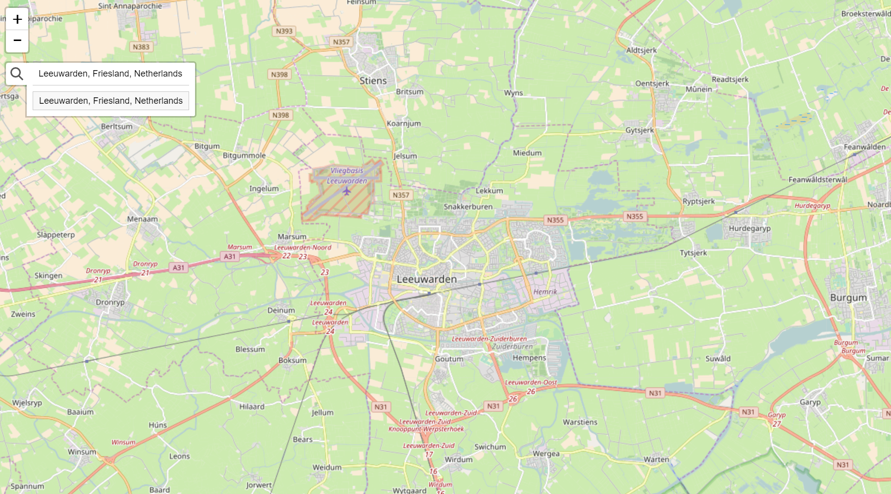

# Leaflet.GeoSearch

<!-- ALL-CONTRIBUTORS-BADGE:START - Do not remove or modify this section -->
[](#contributors-)
<!-- ALL-CONTRIBUTORS-BADGE:END -->

**Demo and Docs: [leaflet-geosearch](https://leaflet-geosearch.meijer.works)**



## Installation

**more docs @** [leaflet-geosearch / installation](https://leaflet-geosearch.meijer.works/#installation)

with npm:

```bash
npm install --save leaflet-geosearch
```

or yarn:

```bash
yarn add leaflet-geosearch
```

## Browser support / Polyfills

**more docs @** [leaflet-geosearch / browser-support / polyfills](https://leaflet-geosearch.meijer.works/#browser-support--polyfills)

This library is written with the latest technologies in mind. Thereby it is required to include some polyfills when you wish to support older browsers. These polyfills are recommended for IE and Safari support:

- [babel-polyfill], for `array.includes` support.
- [unfetch], for `fetch` requests.

## Upgrading to 5.0

5.0 changes some behaviour, not the API. The full list with examples is in the [upgrade notes](https://leaflet-geosearch.meijer.works/upgrading/v5). In short:

- the default `resultFormat` and `popupFormat` escape the label. Pass your own formatters if your provider returns html on purpose.
- a picked suggestion is shown right away instead of being searched again. `requeryOnSelect: true` brings the old behaviour back.
- failed searches fire `geosearch/error` on the map instead of an unhandled promise rejection.
- the Google provider uses `@googlemaps/js-api-loader` 2. `url`, `nonce`, `retries` and `id` are ignored.
- the Esri provider asks for up to 5 locations instead of 1.

# About

This library adds support for geocoding _(address lookup, a.k.a. geosearching)_
to your (web) application. It comes with controls to be embedded in your [Leaflet] map.

Check out the [docs] for various possibilities.

The library uses so-called "providers" to take care of building the correct
service URL and parsing the retrieved data into a uniform format. Thanks to this
architecture, it is pretty easy to add your own providers, so you can use
your own geocoding service(s).

The control comes with a number of default providers:

- [AMap]
- [Bing]
- [Esri]
- [Geocode Earth]
- [Google]
- [Here]
- [LocationIQ]
- [OpenCage]
- [OpenStreetMap]
- [PdokNl]
- [Pelias]
- [Photon]
- [Mapbox](https://docs.mapbox.com/help/tutorials/local-search-geocoding-api/)
- [GeoApiFR](https://geo.api.gouv.fr/adresse)
- [Geoapify](https://apidocs.geoapify.com/docs/geocoding/forward-geocoding/#about)

Although this project is still named `leaflet-geosearch`, the providers also
work without Leaflet, for example to look up addresses in a form. Import them
from `leaflet-geosearch/providers` when Leaflet isn't available, like during
server-side rendering.

# Usage

**more docs @** [leaflet-geosearch / usage](https://leaflet-geosearch.meijer.works/usage)

Let's first start with an little example on how to use this control without
leaflet. For example as an address lookup on a webshop order form. Perhaps to
search for the closest alternative package delivery point? Or to link it to your
own custom map component.

```js
// import
import { OpenStreetMapProvider } from 'leaflet-geosearch';

// setup
const provider = new OpenStreetMapProvider();

// search
const results = await provider.search({ query: input.value });
```

Of course, something like this should be bound to something like a form or
input:

```js
import { OpenStreetMapProvider } from 'leaflet-geosearch';

const form = document.querySelector('form');
const input = form.querySelector('input[type="text"]');

form.addEventListener('submit', async (event) => {
  event.preventDefault();

  const results = await provider.search({ query: input.value });
  console.log(results); // » [{}, {}, {}, ...]
});
```

Instead of es6 `async` / `await` you can also use promises like:

```js
provider.search({ query: '...' }).then(function (result) {
  // do something with result;
});
```

## Server-side rendering

`leaflet-geosearch` imports Leaflet, and Leaflet only runs in a browser. On a
server (Next.js, Nuxt, ...) that ends in `window is not defined`. If you only
need the providers, import them from `leaflet-geosearch/providers` instead. It
has the same providers and doesn't import Leaflet:

```js
import { OpenStreetMapProvider } from 'leaflet-geosearch/providers';
```

The search control needs Leaflet, so only create it in the browser.

## Results

The `search` event of all providers return an array of `result objects`. The
base structure is uniform between the providers. It provides a object like:

```js
const result = {
  x: Number, // lon,
  y: Number, // lat,
  label: String, // formatted address
  bounds: [
    [Number, Number], // s, w - lat, lon
    [Number, Number], // n, e - lat, lon
  ],
  raw: {}, // raw provider result
};
```

The contents of the `raw` property differ per provider. This is the unprocessed
result from the 3th party service. This property is included for developer
convenience. `leaflet-geosearch` does not use it. If you need to know the
contents of this property, you should check the 3th party developer docs. (or
use your debugger)

# Providers

When `OpenStreetMap` does not match your needs; you can also choose to use the
`Bing`, `Esri`, `Geocode Earth`, `Google`, `Here`, `LocationIQ`, `OpenCage`, `Pelias` or `Photon` providers. Most of those providers do however require API
keys. See the documentation pages on the relevant organisations on how to obtain
these keys.

In case you decide to write your own provider, please consider submitting a PR
to share your work with us.

Providers are unaware of any options you can give them. They are simple proxies
to their endpoints. There is only one `special property`, and that is the `params`
option. The difference being; that `params` will be included in the endpoint url.
Often being used for `API KEYS`, where as the other attributes can be used for
provider configuration.

# Using with LeafletJS

This project comes with a leaflet control to hook the search providers into
leaflet. The example below uses the `OpenStreetMap Provider`, but you can exchange
this with on of the other included providers as well as your own custom made
providers. Remember to setup the provider with a `key` when required (Google and
Bing for example).



```js
import L from 'leaflet';
import { GeoSearchControl, OpenStreetMapProvider } from 'leaflet-geosearch';

const provider = new OpenStreetMapProvider();

const searchControl = new GeoSearchControl({
  provider: provider,
});

const map = new L.Map('map');
map.addControl(searchControl);
```

## Leaflet 2

The control works with Leaflet 1.6 and up, and with the Leaflet 2 alpha (the
tests run against 2.0.0-alpha.1). Leaflet 2 has no factory functions like
`L.map()`, so create the map with `new Map()`; the control is used the same way.

Leaflet 2 is only published as ES modules. The CommonJS build of
`leaflet-geosearch` loads it with `require('leaflet')`, which works in Node
20.19+ and 22.12+. In the browser, the UMD build works with Leaflet 2's
`leaflet-global.js`.

# Using with react-leaflet

Usage with `react-leaflet` is similar to the usage with plain Leaflet. This example
uses the new MapBoxProvider and adds an api key to the `params` list when accessing
the remote API. Note the `useMap` hook which is the only notable difference to the
leaflet example.

```jsx
import { GeoSearchControl, MapBoxProvider } from 'leaflet-geosearch';
import { useMap } from 'react-leaflet';
import 'leaflet-geosearch/assets/css/leaflet.css';

const SearchField = ({ apiKey }) => {
  const provider = new MapBoxProvider({
    params: {
      access_token: apiKey,
    },
  });

  // @ts-ignore
  const searchControl = new GeoSearchControl({
    provider: provider,
  });

  const map = useMap();
  useEffect(() => {
    map.addControl(searchControl);
    return () => map.removeControl(searchControl);
  }, []);

  return null;
};
```

The `useEffect` hook used in `SearchField` even allows for conditional rendering of the
search field.

```jsx
import { MapContainer } from 'react-leaflet';
const MyMap = () => {
  // ...
  return (
    <MapContainer>
      {showSearch && <SearchField apiKey={apiKey} />}

      {/* ... */}
    </MapContainer>
  );
};
```

## GeoSearchControl

There are some configurable options like setting the position of the search input
and whether or not a marker should be displayed at the position of the search result.


There are two visual styles of this control. One is the more 'leaflet-way' by
putting the search control under a button (see image above). And one where the
search control is permanently shown as a search bar (see image under
[using with LeafletJS](#using-with-leafletjs)).

**Render style**

This render style can be set by the optional `style` option.

```js
new GeoSearchControl({
  provider: myProvider, // required
  style: 'bar', // optional: bar|button  - default button
}).addTo(map);
```

The bar always sits at the top of the map, in the middle. `position` only places
the button style.

**AutoComplete**

Auto complete can be configured by the parameters `autoComplete` and
`autoCompleteDelay`. A little delay is required to not DDOS the server on every
keystroke.

```js
new GeoSearchControl({
  provider: myProvider, // required
  autoComplete: true, // optional: true|false  - default true
  autoCompleteDelay: 250, // optional: number      - default 250
}).addTo(map);
```

**Show result**

There are a number of options to adjust the way results are visualized.

```js
new GeoSearchControl({
  provider: myProvider, // required
  showMarker: true, // optional: true|false  - default true
  showPopup: false, // optional: true|false  - default false
  marker: {
    // optional: L.MarkerOptions - without icon, Leaflet's default icon is used
    draggable: false,
  },
  popupFormat: ({ query, result }) => result.label, // optional: function    - default returns result label,
  resultFormat: ({ result }) => result.label, // optional: function    - default returns result label
  maxMarkers: 1, // optional: number      - default 1
  retainZoomLevel: false, // optional: true|false  - default false
  zoomToBounds: true, // optional: true|false  - default true
  fitBoundsOptions: {}, // optional: Leaflet FitBoundsOptions - default {}
  reverseOnDragEnd: false, // optional: true|false  - default false
  resultListPosition: 'below', // optional: 'below'|'above'|'auto' - default 'below'
  theme: 'light', // optional: 'light'|'dark'|'auto' - default 'light'
  searchIcon: '', // optional: html of the search button - default the magnifying glass
  markerPopup: true, // optional: true|false  - default true
  popupOptions: {}, // optional: Leaflet PopupOptions - default {}
  animateZoom: true, // optional: true|false  - default true
  flyTo: false, // optional: true|false|Leaflet ZoomPanOptions - default false
  autoClose: false, // optional: true|false  - default false
  searchLabel: 'Enter address', // optional: string      - default 'Enter address'
  keepResult: false, // optional: true|false  - default false
  updateMap: true, // optional: true|false  - default true
  requeryOnSelect: false, // optional: true|false  - default false
  minQueryLength: 1, // optional: number      - default 1
  cacheSize: 0, // optional: number      - default 0
  showResultListOnSubmit: false, // optional: true|false  - default false
});
```

`showMarker` and `showPopup` determine whether or not to show a marker and/or
open a popup with the location text.

`marker` can be set to any instance of a (custom) `L.Icon`.

`popupFormat` is callback function for displaying text on popup.

`resultFormat` is callback function for modifying the search result texts (e. g. in order to hide address components or change its ordering).

Both return html. The default ones escape the label, since it comes from the provider. If you build your own html, escape the parts that come from the result, e.g. with the `escapeHtml` helper of your framework. `notFoundMessage` and `searchIcon` are html too: only pass markup you wrote yourself, never text from users. See [Security](https://leaflet-geosearch.meijer.works/leaflet-control#security) in the docs.

`maxMarker` determines how many last results are kept in memory. Default 1, but
perhaps you want to show the last `x` results when searching for new queries as
well.

`retainZoomLevel` is a setting that fixes the zoomlevel. Default behaviour is to
zoom and pan to the search result. With `retainZoomLevel` on `true`, the map is
only panned.

`zoomToBounds` fits the map to the bounds of a result, when the provider returns them. Most OpenStreetMap results have bounds, so `zoomLevel` only applies to the others. With `zoomToBounds: false` every result is shown at `zoomLevel`, e.g. `{ zoomToBounds: false, zoomLevel: 20 }`.

`fitBoundsOptions` is passed to Leaflet's `fitBounds`. `maxZoom` keeps a single building from zooming in too far, `padding` keeps the result out from under the search bar.

`reverseOnDragEnd` looks up the address when a draggable marker (`marker: { draggable: true }`) is dropped, with the provider that found the result. The popup shows the new address, the input too with `keepResult`, and `geosearch/marker/reverse` is fired. Providers have a `reverse({ lat, lng })` method for this, see the [docs](https://leaflet-geosearch.meijer.works/usage#reverse-geocoding).

`resultListPosition` opens the result list above the input (`'above'`), or above when the control sits in a bottom corner (`'auto'`).

`theme` sets the colors: `'light'`, `'dark'` or `'auto'` (follows the system). The colors are css variables like `--geosearch-background` and `--geosearch-text`, see the [docs](https://leaflet-geosearch.meijer.works/leaflet-control#theme).

`searchIcon` replaces the magnifying glass with your own html, e.g. an svg that uses `currentColor`. Only pass markup you wrote yourself.

`markerPopup: false` gives the marker no popup, `popupOptions` is passed to Leaflet's `bindPopup`.

`animateZoom` controls whether or not the pan/zoom moment is being animated.

`flyTo` flies to the result with Leaflet's `flyTo` and `flyToBounds` instead of jumping there. An object like `{ duration: 1.5 }` is passed to them. `animateZoom: false` turns the animation off for both.

`autoClose` closes the search box and the result list after a result is picked by click or enter. The marker of the result stays.

`keepResult` keeps the picked result in the search field. Without it, `autoClose` clears the text, and closing the box also removes the marker. Escape always clears both.

`updateMap` controls whether or not the map re-centers on the selection.

`requeryOnSelect` searches the provider again when a suggestion is picked. By default the picked suggestion is shown directly when it has coordinates, which saves a request. Turn it on if your provider returns more details on a full search than in its suggestions.

`minQueryLength` is the number of characters to type before the autocomplete searches. Pressing enter always searches.

`cacheSize` keeps the results of the last searches in memory, so typing the same text again (or pressing enter after the suggestions showed up) doesn't send another request. `0` turns the cache off.

`showResultListOnSubmit` shows the results to pick from when enter is pressed, instead of jumping to the first one. A single result is shown right away. Together with `autoComplete: false`, the provider is only searched on enter.

**Multiple providers**

`providers` replaces `provider` with a list of providers and a name for each. With more than one, a select left of the input lets the user pick one of them, or search all at once. Each suggestion then shows the name of its provider.

```js
const searchControl = new GeoSearchControl({
  providers: [
    { label: 'OpenStreetMap', provider: new OpenStreetMapProvider() },
    { label: 'Esri', provider: new EsriProvider() },
  ],
  showProviderSelect: true, // optional: true|false  - default true
  allProvidersLabel: 'All', // optional: string|false - default 'All', false leaves the option out
  providerSelectLabel: 'Search with', // optional: string - accessible name of the select
  fallback: false, // optional: false|'error'|'empty' - default false
});

searchControl.selectProvider(1); // the index in providers, or 'all'
searchControl.getSelectedProvider(); // { index: 1, label: 'Esri', provider }
searchControl.getProviders(); // [{ index: 0, label: 'OpenStreetMap', provider }, ...]
searchControl.setProviderSelectVisible(false);
```

`fallback: 'error'` searches the next provider when the selected one fails, `'empty'` also when it finds nothing. With `showProviderSelect: false` and `allProvidersLabel: false` that's a plain fallback: one search box that keeps working when the first provider is down.

`resultFormat`, `popupFormat` and the events also get the provider that found the result: `({ result, provider }) => ...`.

**Methods**

`reset()` clears the input, the suggestions and the markers. `setQuery(text)` puts text into the input without searching. `setLabels({ searchLabel, clearSearchLabel, notFoundMessage, providerSelectLabel })` changes the texts, for example when the language changes.

```js
searchControl.reset();
searchControl.setQuery('Amsterdam');
searchControl.setLabels({ searchLabel: 'Adres girin' });
```

**Events**

`geosearch/beforeshowlocation` is fired before a result is shown. Calling `event.preventDefault()` skips the marker, the map move and `geosearch/showlocation`.

`geosearch/showlocation` is fired when location is chosen from the result list.

```js
map.on('geosearch/showlocation', yourEventHandler);
```

`geosearch/marker/dragend` is fired when marker has been dragged.

```js
map.on('geosearch/marker/dragend', yourEventHandler);
```

`geosearch/marker/reverse` is fired with `reverseOnDragEnd` when the address of the dropped marker is found.

```js
map.on('geosearch/marker/reverse', ({ location, marker, provider }) => {
  console.log(location.label);
});
```

`geosearch/error` is fired when a search fails, for example when the provider can't be reached. The event has the `error`, the `query`, the `source` (`'autocomplete'` or `'submit'`) and the `provider`. The control also shows its error state until the user types again. With several providers the error state only shows when none of them found anything.

```js
map.on('geosearch/error', ({ error, query, source }) => {
  console.warn(`search for "${query}" failed`, error);
});
```

`geosearch/providerchange` is fired when another provider is picked, by the user or with `selectProvider`. It has the selected `provider` and the list of all `providers`.

```js
map.on('geosearch/providerchange', ({ provider, providers }) => {
  console.log(provider.index, provider.label, providers.length);
});
```

# Development

Checkout the providers to see how easy it is to write your own. For research it
can be interesting to see the difference between Bing and the others; because
Bing does not support `CORS`, and requires `jsonp` to be used instead.

In case you decide to write your own provider, please consider submitting a PR
to share your work with us.

The [contributing guide](CONTRIBUTING.md) has the details: tests, the docs site,
what a new provider needs, and how commit messages and PR titles turn into
releases.

To work on the package:

```bash
npm install
npm test            # unit tests with Vitest, npm run test:watch keeps them running
npm run lint        # types, ESLint and Prettier
npm run build       # the bundles in dist and the types
```

The docs site in `website/` doubles as a development environment. It uses the
package built in `dist`, so run `npm run build` again after changing the source
and reload the page.

```bash
npm install --prefix website
npm run docs:dev    # builds the package and starts the docs site
```

The end-to-end tests run the built bundles in a browser with Playwright:

```bash
npx playwright install chromium   # once
npm run build
npm run test:e2e
```

[leaflet]: http://leafletjs.com
[docs]: https://leaflet-geosearch.meijer.works
[babel-polyfill]: https://npmjs.com/babel-polyfill
[unfetch]: https://npmjs.com/unfetch
[amap]: https://leaflet-geosearch.meijer.works/providers/amap
[bing]: https://leaflet-geosearch.meijer.works/providers/bing
[esri]: https://leaflet-geosearch.meijer.works/providers/esri
[geocode earth]: https://leaflet-geosearch.meijer.works/providers/geocode-earth
[google]: https://leaflet-geosearch.meijer.works/providers/google
[here]: https://leaflet-geosearch.meijer.works/providers/here
[locationiq]: https://leaflet-geosearch.meijer.works/providers/locationiq
[opencage]: https://leaflet-geosearch.meijer.works/providers/opencage
[openstreetmap]: https://leaflet-geosearch.meijer.works/providers/openstreetmap
[pdoknl]: https://leaflet-geosearch.meijer.works/providers/pdoknl
[pelias]: https://leaflet-geosearch.meijer.works/providers/pelias
[photon]: https://leaflet-geosearch.meijer.works/providers/photon

## Contributors ✨

Thanks goes to these wonderful people ([emoji key](https://allcontributors.org/docs/en/emoji-key)):

<!-- ALL-CONTRIBUTORS-LIST:START - Do not remove or modify this section -->
<!-- prettier-ignore-start -->
<!-- markdownlint-disable -->
<table>
  <tbody>
    <tr>
      <td align="center" valign="top" width="14.28%"><a href="https://github.com/smeijer"><br /><sub><b>Stephan Meijer</b></sub></a><br /><a href="#ideas-smeijer" title="Ideas, Planning, & Feedback">🤔</a> <a href="https://github.com/smeijer/leaflet-geosearch/commits?author=smeijer" title="Code">💻</a> <a href="#infra-smeijer" title="Infrastructure (Hosting, Build-Tools, etc)">🚇</a> <a href="#maintenance-smeijer" title="Maintenance">🚧</a> <a href="https://github.com/smeijer/leaflet-geosearch/commits?author=smeijer" title="Tests">⚠️</a></td>
      <td align="center" valign="top" width="14.28%"><a href="https://github.com/yuriizinets"><br /><sub><b>Yurii Zinets</b></sub></a><br /><a href="https://github.com/smeijer/leaflet-geosearch/commits?author=yuriizinets" title="Code">💻</a> <a href="https://github.com/smeijer/leaflet-geosearch/commits?author=yuriizinets" title="Tests">⚠️</a> <a href="#ideas-yuriizinets" title="Ideas, Planning, & Feedback">🤔</a></td>
      <td align="center" valign="top" width="14.28%"><a href="https://github.com/hubnerd"><br /><sub><b>David Hubner</b></sub></a><br /><a href="https://github.com/smeijer/leaflet-geosearch/commits?author=hubnerd" title="Code">💻</a></td>
      <td align="center" valign="top" width="14.28%"><a href="https://ninarski.com/"><br /><sub><b>Nikolay Ninarski</b></sub></a><br /><a href="https://github.com/smeijer/leaflet-geosearch/commits?author=ninio" title="Code">💻</a></td>
      <td align="center" valign="top" width="14.28%"><a href="http://fredrik.computer/"><br /><sub><b>Fredrik Ekelund</b></sub></a><br /><a href="https://github.com/smeijer/leaflet-geosearch/commits?author=fredrikekelund" title="Code">💻</a></td>
      <td align="center" valign="top" width="14.28%"><a href="https://blog.duraffort.fr/"><br /><sub><b>Rémi Duraffort</b></sub></a><br /><a href="https://github.com/smeijer/leaflet-geosearch/commits?author=ivoire" title="Code">💻</a></td>
      <td align="center" valign="top" width="14.28%"><a href="https://github.com/bung87"><br /><sub><b>Bung</b></sub></a><br /><a href="https://github.com/smeijer/leaflet-geosearch/commits?author=bung87" title="Code">💻</a></td>
    </tr>
    <tr>
      <td align="center" valign="top" width="14.28%"><a href="https://github.com/cajus"><br /><sub><b>Cajus Pollmeier</b></sub></a><br /><a href="https://github.com/smeijer/leaflet-geosearch/commits?author=cajus" title="Code">💻</a></td>
      <td align="center" valign="top" width="14.28%"><a href="https://dandascalescu.com/"><br /><sub><b>Dan Dascalescu</b></sub></a><br /><a href="https://github.com/smeijer/leaflet-geosearch/commits?author=dandv" title="Code">💻</a></td>
      <td align="center" valign="top" width="14.28%"><a href="https://github.com/devdattaT"><br /><sub><b>Devdatta Tengshe</b></sub></a><br /><a href="https://github.com/smeijer/leaflet-geosearch/commits?author=devdattaT" title="Code">💻</a></td>
      <td align="center" valign="top" width="14.28%"><a href="https://github.com/emiltem"><br /><sub><b>emiltem</b></sub></a><br /><a href="https://github.com/smeijer/leaflet-geosearch/commits?author=emiltem" title="Code">💻</a></td>
      <td align="center" valign="top" width="14.28%"><a href="http://programmatic.pro/"><br /><sub><b>Johannes Raggam</b></sub></a><br /><a href="https://github.com/smeijer/leaflet-geosearch/commits?author=thet" title="Code">💻</a></td>
      <td align="center" valign="top" width="14.28%"><a href="https://nathancahill.com/"><br /><sub><b>Nathan Cahill</b></sub></a><br /><a href="https://github.com/smeijer/leaflet-geosearch/commits?author=nathancahill" title="Code">💻</a></td>
      <td align="center" valign="top" width="14.28%"><a href="https://timwis.com/"><br /><sub><b>Tim Wisniewski</b></sub></a><br /><a href="https://github.com/smeijer/leaflet-geosearch/commits?author=timwis" title="Code">💻</a></td>
    </tr>
    <tr>
      <td align="center" valign="top" width="14.28%"><a href="http://kaoru.slackwise.net/"><br /><sub><b>Alex Balhatchet</b></sub></a><br /><a href="https://github.com/smeijer/leaflet-geosearch/commits?author=kaoru" title="Code">💻</a> <a href="https://github.com/smeijer/leaflet-geosearch/commits?author=kaoru" title="Tests">⚠️</a> <a href="#ideas-kaoru" title="Ideas, Planning, & Feedback">🤔</a></td>
      <td align="center" valign="top" width="14.28%"><a href="http://andreas.heigl.org/"><br /><sub><b>Andreas Heigl</b></sub></a><br /><a href="https://github.com/smeijer/leaflet-geosearch/commits?author=heiglandreas" title="Code">💻</a></td>
      <td align="center" valign="top" width="14.28%"><a href="https://github.com/konfiot"><br /><sub><b>Arthur Toussaint</b></sub></a><br /><a href="https://github.com/smeijer/leaflet-geosearch/commits?author=konfiot" title="Code">💻</a></td>
      <td align="center" valign="top" width="14.28%"><a href="https://github.com/thataustin"><br /><sub><b>Austin Brown</b></sub></a><br /><a href="https://github.com/smeijer/leaflet-geosearch/commits?author=thataustin" title="Code">💻</a></td>
      <td align="center" valign="top" width="14.28%"><a href="http://brianherbert.com/"><br /><sub><b>Brian Herbert</b></sub></a><br /><a href="https://github.com/smeijer/leaflet-geosearch/commits?author=brianherbert" title="Code">💻</a></td>
      <td align="center" valign="top" width="14.28%"><a href="http://www.opencoder.co.uk/"><br /><sub><b>Chris McDonald</b></sub></a><br /><a href="https://github.com/smeijer/leaflet-geosearch/commits?author=chrismcband" title="Code">💻</a></td>
      <td align="center" valign="top" width="14.28%"><a href="http://www.kobia.net/"><br /><sub><b>David Kobia</b></sub></a><br /><a href="https://github.com/smeijer/leaflet-geosearch/commits?author=dkobia" title="Code">💻</a></td>
    </tr>
    <tr>
      <td align="center" valign="top" width="14.28%"><a href="https://github.com/dimabory"><br /><sub><b> Dmytro Borysovskyi</b></sub></a><br /><a href="https://github.com/smeijer/leaflet-geosearch/commits?author=dimabory" title="Code">💻</a></td>
      <td align="center" valign="top" width="14.28%"><a href="https://github.com/francislavoie"><br /><sub><b>Francis Lavoie</b></sub></a><br /><a href="https://github.com/smeijer/leaflet-geosearch/commits?author=francislavoie" title="Code">💻</a></td>
      <td align="center" valign="top" width="14.28%"><a href="https://github.com/summerisgone"><br /><sub><b>Ivan Gromov</b></sub></a><br /><a href="https://github.com/smeijer/leaflet-geosearch/commits?author=summerisgone" title="Code">💻</a></td>
      <td align="center" valign="top" width="14.28%"><a href="https://twitter.com/deadbeef404"><br /><sub><b>Jason Pettett</b></sub></a><br /><a href="https://github.com/smeijer/leaflet-geosearch/commits?author=deadbeef404" title="Code">💻</a></td>
      <td align="center" valign="top" width="14.28%"><a href="https://github.com/3limin4t0r"><br /><sub><b>Johan</b></sub></a><br /><a href="https://github.com/smeijer/leaflet-geosearch/commits?author=3limin4t0r" title="Code">💻</a></td>
      <td align="center" valign="top" width="14.28%"><a href="https://github.com/kreegr"><br /><sub><b>Matt Krueger</b></sub></a><br /><a href="https://github.com/smeijer/leaflet-geosearch/commits?author=kreegr" title="Code">💻</a></td>
      <td align="center" valign="top" width="14.28%"><a href="https://github.com/Mithgol"><br /><sub><b>Mithgol</b></sub></a><br /><a href="https://github.com/smeijer/leaflet-geosearch/commits?author=Mithgol" title="Code">💻</a></td>
    </tr>
    <tr>
      <td align="center" valign="top" width="14.28%"><a href="https://github.com/mosh11"><br /><sub><b>mosh11</b></sub></a><br /><a href="https://github.com/smeijer/leaflet-geosearch/commits?author=mosh11" title="Code">💻</a></td>
      <td align="center" valign="top" width="14.28%"><a href="https://sajjad.in/"><br /><sub><b>Sajjad Anwar</b></sub></a><br /><a href="https://github.com/smeijer/leaflet-geosearch/commits?author=geohacker" title="Code">💻</a></td>
      <td align="center" valign="top" width="14.28%"><a href="http://snkashis.com/"><br /><sub><b>Steve</b></sub></a><br /><a href="https://github.com/smeijer/leaflet-geosearch/commits?author=snkashis" title="Code">💻</a></td>
      <td align="center" valign="top" width="14.28%"><a href="https://stuartpb.com/"><br /><sub><b>Stuart P. Bentley</b></sub></a><br /><a href="https://github.com/smeijer/leaflet-geosearch/commits?author=stuartpb" title="Code">💻</a></td>
      <td align="center" valign="top" width="14.28%"><a href="https://github.com/joshrainwater"><br /><sub><b>joshrainwater</b></sub></a><br /><a href="https://github.com/smeijer/leaflet-geosearch/commits?author=joshrainwater" title="Code">💻</a></td>
      <td align="center" valign="top" width="14.28%"><a href="https://maxlath.eu/"><br /><sub><b>maxlath</b></sub></a><br /><a href="https://github.com/smeijer/leaflet-geosearch/commits?author=maxlath" title="Code">💻</a></td>
      <td align="center" valign="top" width="14.28%"><a href="https://github.com/pwldp"><br /><sub><b>Dariusz Pawlak</b></sub></a><br /><a href="https://github.com/smeijer/leaflet-geosearch/commits?author=pwldp" title="Code">💻</a></td>
    </tr>
    <tr>
      <td align="center" valign="top" width="14.28%"><a href="https://github.com/IvelinYR"><br /><sub><b>Ivelin Ralev</b></sub></a><br /><a href="https://github.com/smeijer/leaflet-geosearch/commits?author=IvelinYR" title="Code">💻</a> <a href="https://github.com/smeijer/leaflet-geosearch/commits?author=IvelinYR" title="Tests">⚠️</a> <a href="#ideas-IvelinYR" title="Ideas, Planning, & Feedback">🤔</a></td>
      <td align="center" valign="top" width="14.28%"><a href="https://github.com/SrihariThalla"><br /><sub><b>Srihari Thalla</b></sub></a><br /><a href="https://github.com/smeijer/leaflet-geosearch/commits?author=SrihariThalla" title="Code">💻</a> <a href="https://github.com/smeijer/leaflet-geosearch/commits?author=SrihariThalla" title="Tests">⚠️</a> <a href="#ideas-SrihariThalla" title="Ideas, Planning, & Feedback">🤔</a></td>
      <td align="center" valign="top" width="14.28%"><a href="https://github.com/tirli"><br /><sub><b>Kate Lizogubova</b></sub></a><br /><a href="https://github.com/smeijer/leaflet-geosearch/commits?author=tirli" title="Code">💻</a></td>
      <td align="center" valign="top" width="14.28%"><a href="https://github.com/CoryLR"><br /><sub><b>Cory Leigh Rahman</b></sub></a><br /><a href="#ideas-CoryLR" title="Ideas, Planning, & Feedback">🤔</a> <a href="https://github.com/smeijer/leaflet-geosearch/commits?author=CoryLR" title="Code">💻</a></td>
      <td align="center" valign="top" width="14.28%"><a href="https://github.com/mrsimpson"><br /><sub><b>Oliver Jägle</b></sub></a><br /><a href="https://github.com/smeijer/leaflet-geosearch/commits?author=mrsimpson" title="Code">💻</a></td>
      <td align="center" valign="top" width="14.28%"><a href="https://github.com/Dusty211"><br /><sub><b>Kyle Houghton</b></sub></a><br /><a href="https://github.com/smeijer/leaflet-geosearch/commits?author=Dusty211" title="Code">💻</a></td>
      <td align="center" valign="top" width="14.28%"><a href="https://github.com/nikitauskas"><br /><sub><b>nikitauskas</b></sub></a><br /><a href="https://github.com/smeijer/leaflet-geosearch/commits?author=nikitauskas" title="Code">💻</a></td>
    </tr>
    <tr>
      <td align="center" valign="top" width="14.28%"><a href="https://github.com/patou"><br /><sub><b>Patrice De Saint Steban</b></sub></a><br /><a href="https://github.com/smeijer/leaflet-geosearch/commits?author=patou" title="Code">💻</a> <a href="https://github.com/smeijer/leaflet-geosearch/commits?author=patou" title="Documentation">📖</a></td>
      <td align="center" valign="top" width="14.28%"><a href="https://github.com/AntoineAA"><br /><sub><b>AntoineAA</b></sub></a><br /><a href="https://github.com/smeijer/leaflet-geosearch/commits?author=AntoineAA" title="Code">💻</a></td>
      <td align="center" valign="top" width="14.28%"><a href="https://github.com/HolyMarcell"><br /><sub><b>HolyMarcell</b></sub></a><br /><a href="https://github.com/smeijer/leaflet-geosearch/commits?author=HolyMarcell" title="Documentation">📖</a></td>
      <td align="center" valign="top" width="14.28%"><a href="https://github.com/grigorpavlov"><br /><sub><b>Grigor Pavlov</b></sub></a><br /><a href="https://github.com/smeijer/leaflet-geosearch/commits?author=grigorpavlov" title="Code">💻</a></td>
      <td align="center" valign="top" width="14.28%"><a href="https://geocode.earth"><br /><sub><b>Peter Johnson</b></sub></a><br /><a href="https://github.com/smeijer/leaflet-geosearch/commits?author=missinglink" title="Code">💻</a> <a href="https://github.com/smeijer/leaflet-geosearch/commits?author=missinglink" title="Tests">⚠️</a></td>
      <td align="center" valign="top" width="14.28%"><a href="http://about.me/arnaudferrand"><br /><sub><b>Arnaud Ferrand</b></sub></a><br /><a href="https://github.com/smeijer/leaflet-geosearch/commits?author=tsamaya" title="Documentation">📖</a> <a href="https://github.com/smeijer/leaflet-geosearch/commits?author=tsamaya" title="Code">💻</a></td>
      <td align="center" valign="top" width="14.28%"><a href="https://github.com/kstratis"><br /><sub><b>Konstantinos Stratis</b></sub></a><br /><a href="https://github.com/smeijer/leaflet-geosearch/commits?author=kstratis" title="Code">💻</a> <a href="https://github.com/smeijer/leaflet-geosearch/commits?author=kstratis" title="Tests">⚠️</a> <a href="https://github.com/smeijer/leaflet-geosearch/commits?author=kstratis" title="Documentation">📖</a></td>
    </tr>
    <tr>
      <td align="center" valign="top" width="14.28%"><a href="https://github.com/darrenklein"><br /><sub><b>Darren</b></sub></a><br /><a href="https://github.com/smeijer/leaflet-geosearch/commits?author=darrenklein" title="Code">💻</a> <a href="https://github.com/smeijer/leaflet-geosearch/commits?author=darrenklein" title="Tests">⚠️</a> <a href="https://github.com/smeijer/leaflet-geosearch/commits?author=darrenklein" title="Documentation">📖</a></td>
      <td align="center" valign="top" width="14.28%"><a href="https://paulschreiber.com/"><br /><sub><b>Paul Schreiber</b></sub></a><br /><a href="https://github.com/smeijer/leaflet-geosearch/commits?author=paulschreiber" title="Code">💻</a></td>
      <td align="center" valign="top" width="14.28%"><a href="https://nsilvestri.me/"><br /><sub><b>Nick Silvestri</b></sub></a><br /><a href="#ideas-nsilvestri" title="Ideas, Planning, & Feedback">🤔</a> <a href="https://github.com/smeijer/leaflet-geosearch/commits?author=nsilvestri" title="Code">💻</a></td>
      <td align="center" valign="top" width="14.28%"><a href="https://github.com/teriblus"><br /><sub><b>teriblus</b></sub></a><br /><a href="https://github.com/smeijer/leaflet-geosearch/commits?author=teriblus" title="Code">💻</a></td>
      <td align="center" valign="top" width="14.28%"><a href="https://github.com/t1m0thy"><br /><sub><b>Tim Hirzel</b></sub></a><br /><a href="https://github.com/smeijer/leaflet-geosearch/commits?author=t1m0thy" title="Code">💻</a></td>
      <td align="center" valign="top" width="14.28%"><a href="http://www.fit.vutbr.cz/~ibarina/"><br /><sub><b>David Barina</b></sub></a><br /><a href="https://github.com/smeijer/leaflet-geosearch/commits?author=xbarin02" title="Code">💻</a></td>
      <td align="center" valign="top" width="14.28%"><a href="https://github.com/mugu-fatman"><br /><sub><b>mugu-fatman</b></sub></a><br /><a href="https://github.com/smeijer/leaflet-geosearch/commits?author=mugu-fatman" title="Code">💻</a></td>
    </tr>
    <tr>
      <td align="center" valign="top" width="14.28%"><a href="http://zachstednick.com"><br /><sub><b>Zach Stednick</b></sub></a><br /><a href="https://github.com/smeijer/leaflet-geosearch/commits?author=stedy" title="Documentation">📖</a></td>
      <td align="center" valign="top" width="14.28%"><a href="https://github.com/mtmail"><br /><sub><b>mtmail</b></sub></a><br /><a href="https://github.com/smeijer/leaflet-geosearch/commits?author=mtmail" title="Code">💻</a></td>
      <td align="center" valign="top" width="14.28%"><a href="https://github.com/franciscofsales"><br /><sub><b>Francisco Sales</b></sub></a><br /><a href="https://github.com/smeijer/leaflet-geosearch/commits?author=franciscofsales" title="Code">💻</a></td>
      <td align="center" valign="top" width="14.28%"><a href="https://www.ramazansancar.com.tr/?utm_source=github&utm_medium=bio&utm_campaign=@ramazansancar"><br /><sub><b>Ramazan Sancar</b></sub></a><br /><a href="https://github.com/smeijer/leaflet-geosearch/commits?author=ramazansancar" title="Code">💻</a> <a href="#maintenance-ramazansancar" title="Maintenance">🚧</a> <a href="https://github.com/smeijer/leaflet-geosearch/pulls?q=is%3Apr+reviewed-by%3Aramazansancar" title="Reviewed Pull Requests">👀</a></td>
      <td align="center" valign="top" width="14.28%"><a href="https://github.com/simon04"><br /><sub><b>Simon Legner</b></sub></a><br /><a href="https://github.com/smeijer/leaflet-geosearch/commits?author=simon04" title="Documentation">📖</a></td>
      <td align="center" valign="top" width="14.28%"><a href="https://github.com/JaZo"><br /><sub><b>Jasper Zonneveld</b></sub></a><br /><a href="https://github.com/smeijer/leaflet-geosearch/commits?author=JaZo" title="Code">💻</a></td>
      <td align="center" valign="top" width="14.28%"><a href="https://datengraben.com"><br /><sub><b>Chris</b></sub></a><br /><a href="https://github.com/smeijer/leaflet-geosearch/commits?author=datengraben" title="Documentation">📖</a></td>
    </tr>
    <tr>
      <td align="center" valign="top" width="14.28%"><a href="http://jeremy.ng"><br /><sub><b>Jeremy Nguyen</b></sub></a><br /><a href="https://github.com/smeijer/leaflet-geosearch/commits?author=jeremy-code" title="Code">💻</a></td>
    </tr>
  </tbody>
</table>

<!-- markdownlint-restore -->
<!-- prettier-ignore-end -->

<!-- ALL-CONTRIBUTORS-LIST:END -->

This project follows the [all-contributors](https://github.com/all-contributors/all-contributors) specification. Contributions of any kind welcome!
